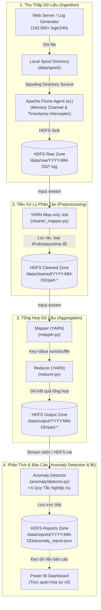

# Hệ Thống Phân Tích Nhật Ký Web Server & Phát Hiện Bất Thường (Big Data)

> **Khóa học:** Samsung Innovation Campus (SIC) - Big Data Course  
> **Nhóm thực hiện:** Group 3  
> **Thành viên:** 
> - **Dương Đình Hoàng (Leader):** Kiến trúc hệ thống, Hadoop MapReduce & Bộ luật Anomaly Detection.
> - **Đặng Văn Vinh:** Sinh dữ liệu web logs, cấu hình Apache Flume Ingestion nạp HDFS.
> - **Nông Minh Trí & Triệu Văn Huy:** Quản lý cấu trúc lưu trữ HDFS phân vùng theo ngày, tiền xử lý dữ liệu.
> - **Lý Việt Hoàng:** Kiểm thử hệ thống, tổng hợp kết quả, viết báo cáo & thiết kế Slide.

---

## 1. Kiến Trúc Tổng Thể Hệ Thống

Hệ thống hoạt động theo mô hình **Batch Processing phân tán ngoại tuyến (Offline Big Data Analytics)** trên cụm Hadoop: dữ liệu nhật ký web server được thu thập định kỳ, làm sạch, tổng hợp phân tán qua MapReduce và đánh giá theo 6 quy tắc bất thường để xuất báo cáo phân tích cho Power BI.



---

## 2. Cấu Trúc Thư Mục Dự Án

```text
Big_Data_ICTU/
├── config/
│   └── settings.py          # Cấu hình ngưỡng phát hiện, dải mạng, đường dẫn HDFS
├── data/
│   ├── generate_logs.py     # Giả lập sinh 150,000+ log/ngày kèm anomaly & log rác
│   └── spool/               # Thư mục đệm nạp log cho Flume
├── flume/
│   ├── flume-hdfs.conf      # File cấu hình chuẩn Flume Agent (Source -> Channel -> Sink)
│   └── start_flume.sh       # Script khởi chạy Flume tự động nhận diện thư mục
├── preprocessing/
│   ├── cleaner_mapper.py    # Map-only Streaming lọc dữ liệu rác, ghi nhận Hadoop Counters
│   ├── cleaner.py           # Tiền xử lý standalone phục vụ kiểm tra ngoại tuyến
│   └── run_cleaner.sh       # Script submit Job tiền xử lý lên cụm YARN
├── mapreduce/
│   ├── mapper.py            # Bóc tách trường, ánh xạ chỉ số theo giờ, IP, endpoint
│   ├── reducer.py           # Tính tổng request, lỗi ERROR, lỗi 5xx, độ trễ trung bình
│   └── run_job.sh           # Script submit Job Hadoop Streaming Aggregation lên YARN
├── anomaly/
│   └── detector.py          # Đánh giá 6 quy tắc, xuất báo cáo JSON lên HDFS
├── UBUNTU_VALIDATION.md     # Hướng dẫn chi tiết quy trình kiểm thử trên máy ảo Ubuntu
├── run_pipeline.sh          # Script điều phối thực thi tự động toàn bộ 6 bước
├── Dockerfile               # Đóng gói pipeline runner (phương án thử nghiệm phụ)
├── docker-compose.yml       # Cấu hình cụm Hadoop phân tán (phương án thử nghiệm phụ)
└── hadoop.env               # Biến môi trường cho container Hadoop
```

---

## 3. Hướng Dẫn Vận Hành

### Cách 1: Triển khai trực tiếp trên máy ảo Ubuntu / Linux (Phương án chính)

Đây là môi trường nghiệm thu và vận hành chính thức của đề tài trên cụm Hadoop thật.

#### Bước 1: Khởi động cụm dịch vụ Hadoop & Flume (Terminal 1)

1. **Khởi động HDFS, YARN và JobHistoryServer:**
   ```bash
   start-dfs.sh
   start-yarn.sh
   mr-jobhistory-daemon.sh start historyserver
   ```
   *Kiểm tra lệnh `jps` đảm bảo có đủ: `NameNode`, `DataNode`, `ResourceManager`, `NodeManager`, `JobHistoryServer`.*

2. **Khởi động Flume Agent:**
   ```bash
   cd ~/log-simulation/Big_Data_ICTU
   bash flume/start_flume.sh
   ```
   *Giữ Terminal 1 hoạt động để Flume theo dõi thư mục `data/spool` và tự động nạp log lên HDFS.*

---

#### Bước 2: Thực thi Pipeline phân tích log (Terminal 2)

Mở **Terminal 2**, chuyển vào thư mục dự án:

**Lựa chọn 2.1: Chạy tự động toàn bộ luồng (Khuyến nghị):**
```bash
cd ~/log-simulation/Big_Data_ICTU
bash run_pipeline.sh
```

**Lựa chọn 2.2: Chạy thủ công từng bước:**
1. **Sinh dữ liệu log:**
   ```bash
   python3 data/generate_logs.py
   ```
2. **Kiểm tra dữ liệu nạp trên HDFS Raw Zone:**
   ```bash
   hdfs dfs -ls /data/raw/$(date +%F)
   ```
3. **Chạy tiền xử lý Map-only trên YARN:**
   ```bash
   bash preprocessing/run_cleaner.sh $(date +%F)
   ```
4. **Chạy tổng hợp MapReduce trên YARN:**
   ```bash
   bash mapreduce/run_job.sh $(date +%F)
   ```
5. **Chạy phát hiện bất thường & xuất báo cáo HDFS:**
   ```bash
   python3 anomaly/detector.py --date $(date +%F)
   ```

---

#### Bước 3: Kiểm tra kết quả trên HDFS

```bash
# 1. Xem mẫu dữ liệu sạch sau bước tiền xử lý
hdfs dfs -cat /data/cleaned/$(date +%F)/part-* | head -n 5

# 2. Xem các chỉ số tổng hợp MapReduce
hdfs dfs -cat /data/output/$(date +%F)/part-* | head -n 30

# 3. Xem báo cáo phát hiện bất thường JSON
hdfs dfs -cat /data/reports/$(date +%F)/anomaly_report.json
```

---

### Cách 2: Triển khai bằng Docker Compose (Phương án phụ / Thử nghiệm)

Phương án Docker Compose đang được chuẩn bị để đóng gói môi trường phục vụ mục đích kiểm thử đóng gói trong tương lai.

```bash
# 1. Khởi động cụm Hadoop container
docker compose up -d

# 2. Theo dõi tiến trình
docker logs -f log-pipeline-runner

# 3. Giao diện Web UI quản trị cụm:
# - HDFS NameNode Web UI: http://localhost:9870
# - YARN Resource Manager: http://localhost:8088
```

---

## 4. 6 Quy Tắc Phát Hiện Bất Thường

Hệ thống đánh giá sự cố dựa trên 6 quy tắc được tính toán trực tiếp từ kết quả tổng hợp MapReduce:

1. **Quy tắc 1 (Lưu lượng truy cập tăng vọt - R01_TRAFFIC_SPIKE):**
   - So sánh lưu lượng từng giờ với phân phối thống kê của 24 giờ trong ngày.
   - Kích hoạt `WARNING` khi vượt `mean + 2*std`; kích hoạt `CRITICAL` khi vượt `mean + 3*std`.
2. **Quy tắc 2 (Tỷ lệ log ERROR cao - R02_ERROR_RATE):**
   - Đếm số log mức `ERROR` chia cho tổng lượng truy cập trong cùng khung giờ.
   - Cảnh báo khi tỷ lệ lỗi vượt ngưỡng `MAX_ERROR_RATE_PERCENT` (mặc định 5.0%).
3. **Quy tắc 3 (Tỷ lệ lỗi máy chủ HTTP 5xx cao - R03_HTTP_5XX_RATE):**
   - Tính tỷ lệ các request có mã phản hồi `500`, `503` trên tổng số request của giờ đó.
   - Cảnh báo `CRITICAL` khi tỷ lệ lỗi 5xx vượt ngưỡng `MAX_5XX_RATE_PERCENT` (mặc định 5.0%).
4. **Quy tắc 4 (Spam truy cập / Tấn công DoS theo IP - R04_IP_FLOOD):**
   - Theo dõi số lượng request từ một địa chỉ IP duy nhất trong từng giờ.
   - Cảnh báo `CRITICAL` khi một IP gửi $\ge 1,000$ request/giờ (`MAX_IP_REQUESTS_PER_HOUR`).
5. **Quy tắc 5 (Thời gian phản hồi trung bình theo giờ quá chậm - R05_RESPONSE_TIME):**
   - Đánh giá thời gian xử lý trung bình theo từng khung giờ (`avg_response_time_ms`).
   - Cảnh báo `WARNING` khi thời gian xử lý trung bình trong giờ $\ge 2,000\text{ ms}$ (2 giây).
6. **Quy tắc 6 (Thống kê xếp hạng endpoint gặp lỗi nhiều nhất):**
   - Tổng hợp số lần gặp lỗi (`status_code >= 400`) trên từng đường dẫn chức năng trong toàn bộ 24 giờ.
   - Xếp hạng và lưu thành nhóm kết quả riêng `top_error_endpoints` trong file JSON để phục vụ biểu đồ phân tích trên Power BI mà không nhầm lẫn với danh sách cảnh báo sự cố tức thời.
